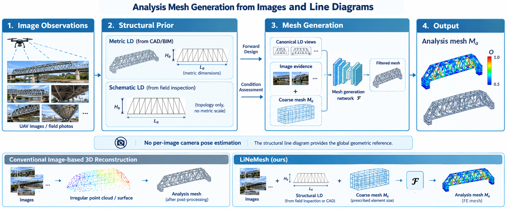

# LiNeMesh

**Analysis mesh generation from images and structural line diagrams**

LiNeMesh generates the analysis mesh (the discretized analysis domain) of civil structures for finite element analysis (FEA) from multi-view images (UAV or handheld photos, or renders of a CAD/BIM model) and a structural line diagram (LD). It classifies the elements of a user-prescribed coarse hexahedral mesh as occupied or empty. The LD provides the spatial reference, so no per-image camera pose estimation is needed, and the element size is set by the user. The mesh is metric when the LD is metric (from CAD/BIM or a few field measurements); with a schematic LD it is defined in the LD frame. Materials, boundary conditions and loads are defined afterwards in the FE software.



---

## Contents

- [Repository structure](#repository-structure)
- [1. Installation](#1-installation)
- [2. Download the BridgeNet dataset](#2-download-the-bridgenet-dataset)
- [3. Download the pretrained model](#3-download-the-pretrained-model)
- [4. Evaluation: generate a mesh with the pretrained model](#4-evaluation-generate-a-mesh-with-the-pretrained-model)
- [5. Training](#5-training)
- [6. Synthetic data from your own line diagram (Blender)](#6-synthetic-data-from-your-own-line-diagram-blender)
- [Data format](#data-format)
- [Citation](#citation)
- [License](#license)

---

## Repository structure

```
LiNeMesh/
├── 01_train_LiNeMesh.ipynb       # training notebook
├── 01_LM_mesh_viz.py             # evaluation: mesh generation, FE mesh export, metrics, visualisation
├── 01_LM_synthetic_data.py       # synthetic data generation from a user-defined LD (Blender)
├── LM_models.py                  # LiNeMesh network
├── LM_utils.py                   # canonical cameras, projection, FE mesh assembly/export, metrics
├── LM_paths.py                   # all paths and download locations (relative to the repo)
├── requirements.txt
├── scripts/
│   ├── download_bridgenet.py     # downloads and unpacks BridgeNet into data/bridgenet/
│   ├── download_weights.py       # downloads the pretrained model into weights/
│   ├── mesh_from_points.py       # saved (N*9, 3) output -> FE mesh (.vtk/.inp) and metrics
│   └── install_blender_deps.py   # installs trimesh/scipy/rtree into Blender's Python
├── data/
│   └── bridgenet_manifest.json   # list of dataset archives (GitHub release assets)
├── weights/                      # pretrained / trained models (*.pth, downloaded)
├── assets/
│   ├── graphical_abstract.png
│   ├── textures/                 # optional member textures for synthetic data
│   └── backgrounds/              # optional ground textures for synthetic data
└── outputs/                      # generated meshes (created on first run)
```

Every path is resolved relative to the cloned repository in `LM_paths.py`, so the scripts and the notebook run as they are once the repository is cloned. To keep the dataset on another disk, set the environment variable `LINEMESH_DATA` to that folder.

---

## 1. Installation

**Clone the repository**

```bash
git clone https://github.com/tmatiki2/LiNeMesh.git
cd LiNeMesh
```

**Create an environment** (Python 3.10 or 3.11 recommended)

With conda:

```bash
conda create -n linemesh python=3.10 -y
conda activate linemesh
```

or with venv:

```bash
python -m venv .venv
source .venv/bin/activate          # Windows: .venv\Scripts\activate
```

**Install the dependencies**

For GPU training, first install the CUDA build of PyTorch for your system from [pytorch.org](https://pytorch.org/get-started/locally/), for example:

```bash
pip install torch torchvision --index-url https://download.pytorch.org/whl/cu121
```

Then install the requirements:

```bash
pip install -r requirements.txt
```

The ImageNet weights of the ResNet backbones are downloaded automatically by `torchvision` the first time the model is built.

---

## 2. Download the BridgeNet dataset

```bash
python scripts/download_bridgenet.py               # train + test
python scripts/download_bridgenet.py --split test  # test split only (enough for evaluation)
```

The archives are downloaded from this repository's [Releases](https://github.com/tmatiki2/LiNeMesh/releases) and unpacked into:

```
data/bridgenet/train/<id>/<id>_render/
data/bridgenet/test/<id>/<id>_render/
```

> **Note:** BridgeNet is being prepared for release. Until it is published, the download script reports that the archives are not available yet.

---

## 3. Download the pretrained model

```bash
python scripts/download_weights.py
```

This saves `weights/mod_brdgnet_ptrain.pth`. You can skip this step, because `01_LM_mesh_viz.py` downloads the weights automatically on its first run.

---

## 4. Evaluation: generate a mesh with the pretrained model

```bash
python 01_LM_mesh_viz.py
```

The script:
1. picks a BridgeNet test domain (the five reported in the paper, 05015, 05209, 05311, 05328 and 05384, or one of the additional test examples);
2. builds a coarse hexahedral mesh around the LD with a prescribed element size;
3. renders the canonical LD views and combines them with the field images;
4. keeps the elements predicted as occupied, with their occupancy confidence;
5. assembles the FE mesh: unique nodes (coincident nodes closer than 10⁻⁴ m merged) and 8-node hexahedral connectivity, and reports its number of nodes, elements, connected components and boundary faces;
6. reports the metrics of the paper against the ground-truth point cloud at τ = 0.05 and τ = 0.10 m;
7. saves the mesh to `outputs/` and shows its boundary faces coloured by occupancy confidence in an Open3D window.

**Metrics** (computed on the unique mesh points, as in the paper):

| Metric | Definition |
|---|---|
| Precision *P* | fraction of mesh points within τ of the reference |
| Recall *R* | fraction of reference points within τ of the mesh (completeness) |
| *F*1 | 2*PR* / (*P* + *R*) |
| Accuracy *A* | mean distance from the mesh points to the reference |
| IoU | volumetric intersection-over-union of the occupied voxels of edge τ (enclosed interiors filled) |
| *V*/*V*ref | ratio of the occupied volumes (1 is ideal; > 1 excess, < 1 missing material) |

**Outputs** (`outputs/`):

| File | Content |
|---|---|
| `linemesh_<id>.vtk` | hexahedral mesh with the occupancy confidence of each element (open in ParaView) |
| `linemesh_<id>.inp` | the same mesh as Abaqus C3D8 elements (nodes and elements only) |
| `linemesh_<id>_nodes.npy`, `linemesh_<id>_elements.npy` | unique nodes `(M, 3)` and connectivity `(K, 8)` (VTK / C3D8 vertex order) |
| `linemesh_<id>_mesh_points.npy` | raw output `(N*9, 3)`: centroid and 8 corners of each occupied element |

The candidate cubes evaluated by the network may overlap; the FE mesh rebuilds each occupied element as a cube of the coarse-mesh size about its centroid, so neighbouring elements share faces (a conforming mesh).

Options:

| Option | Default | Description |
|---|---|---|
| `--sample ID` | random paper sample | test domain id, e.g. `--sample 5040` |
| `--n-views N` | 25 | number of field images used |
| `--mesh-size H` | 0.05 | element size of the coarse mesh |
| `--weights FILE` | `weights/mod_brdgnet_ptrain.pth` | model weights |
| `--no-vis` | off | do not open a window (servers / SSH); results are still saved |
| `--seed N` | none | random seed for reproducible view selection |
| `--wireframe` | off | also draw the element edges |

Example:

```bash
python 01_LM_mesh_viz.py --sample 5015 --mesh-size 0.05 --no-vis
```

**Converting a saved output.** Any `(N*9, 3)` LiNeMesh output can be converted to an FE mesh, and evaluated against a reference point cloud, with:

```bash
python scripts/mesh_from_points.py outputs/linemesh_05015_mesh_points.npy --ref reference.npy --tau 0.05 0.10
```

or from Python:

```python
from LM_utils import points_to_fe_mesh, save_fe_mesh, unique_points, pointcloud_metrics
nodes, elements, keep, info = points_to_fe_mesh(points, tol=1e-4, element_size="auto", return_info=True)
save_fe_mesh("mesh.vtk", nodes, elements)                      # or "mesh.inp"
m = pointcloud_metrics(unique_points(points), reference, threshold=0.05)
```

---

## 5. Training

```bash
jupyter notebook 01_train_LiNeMesh.ipynb
```

Run all cells. The notebook:
- reads the training domains from `data/bridgenet/train` (no paths to edit);
- trains the network with the settings used in the paper;
- saves the best checkpoint to `weights/mod_lm_brdnet.pth`.

To train on your own synthetic domains (Section 6), set `DATA_DIR = SYNTH_DIR / "train"` in the data-loading cell. To evaluate your trained model, run:

```bash
python 01_LM_mesh_viz.py --weights weights/mod_lm_brdnet.pth
```

A CUDA GPU is strongly recommended for training.

---

## 6. Synthetic data from your own line diagram (Blender)

`01_LM_synthetic_data.py` generates training domains for a user-defined LD. For each domain it:
- perturbs the LD;
- builds prismatic or cylindrical members of random size around it;
- samples occupancy/SDF points;
- renders field-like images with random cameras, textures and lighting in Blender Cycles.

The output uses the BridgeNet layout, so the training notebook can use it directly.

**6.1 Install Blender** (4.2 or newer; developed with Blender 5.1) from [blender.org](https://www.blender.org/download/), and make sure the `blender` command is available. Otherwise, use the full path to the executable in the commands below, e.g. `~/blender-5.1.2-linux-x64/blender` or `"C:\Program Files\Blender Foundation\Blender 5.1\blender.exe"`.

**6.2 Install the extra packages into Blender's Python** (once):

```bash
blender -b --factory-startup -P scripts/install_blender_deps.py
```

**6.3 Define your line diagram.** Edit `LD_geom()` near the top of `01_LM_synthetic_data.py`. It returns an `(N, 2, 3)` array with the two end nodes `[x, y, z]` of each of the N members; the provided example is a two-sided truss bridge. Alternatively, save your LD as a `.npy` file and pass it with `--ld`.

**6.4 Generate the data** in Blender's background (offline) mode, from the repository folder:

```bash
blender -b --factory-startup -P 01_LM_synthetic_data.py -- --n-domains 100 --n-images 50
```

With your own LD file:

```bash
blender -b --factory-startup -P 01_LM_synthetic_data.py -- --ld my_ld.npy --n-domains 500
```

Everything after `--` is passed to the script:

| Option | Default | Description |
|---|---|---|
| `--n-domains N` | 100 | number of domains to generate |
| `--n-images N` | 50 | images rendered per domain |
| `--out DIR` | `data/synthetic/train` | output folder |
| `--start-id N` | next free id | id of the first domain (useful for several parallel runs) |
| `--ld FILE` | `LD_geom()` | LD geometry as an `(N, 2, 3)` `.npy` array |
| `--samples N` | 32 | Cycles samples per image |
| `--cpu` | off | render on the CPU (by default the first available GPU is used: OptiX, CUDA, HIP, Metal or oneAPI) |
| `--seed N` | none | random seed |

**Optional textures.** Put member textures (`*.png`, `*.jpg`) in `assets/textures/` and ground textures in `assets/backgrounds/`. When these folders are empty, random colours are used.

---

## Data format

Each domain (BridgeNet or synthetic) is a folder `<id>/<id>_render/` containing:

| File | Content |
|---|---|
| `img_<j>.jpg` | field image *j* (640 × 480) |
| `trans_<j>.npy`, `rots_<j>.npy` | camera position and world-to-camera rotation of image *j* |
| `line_bars.npy` | structural LD, `(N, 2, 3)` |
| `pts.npy`, `sdf.npy` | sampled points and their signed-distance labels (training) |
| `Km.npy` | camera intrinsics (synthetic data) |
| `dense_pts.npy` | dense ground-truth point cloud (test split, used for the metrics) |

---

## Citation

If you use LiNeMesh or BridgeNet, please cite:

```bibtex
@article{linemesh,
  title   = {LiNeMesh: Analysis Mesh Generation from Images and Line Diagrams},
  author  = {To be added on publication},
  journal = {},
  year    = {2026}
}
```

## License

Released under the [MIT License](LICENSE).
